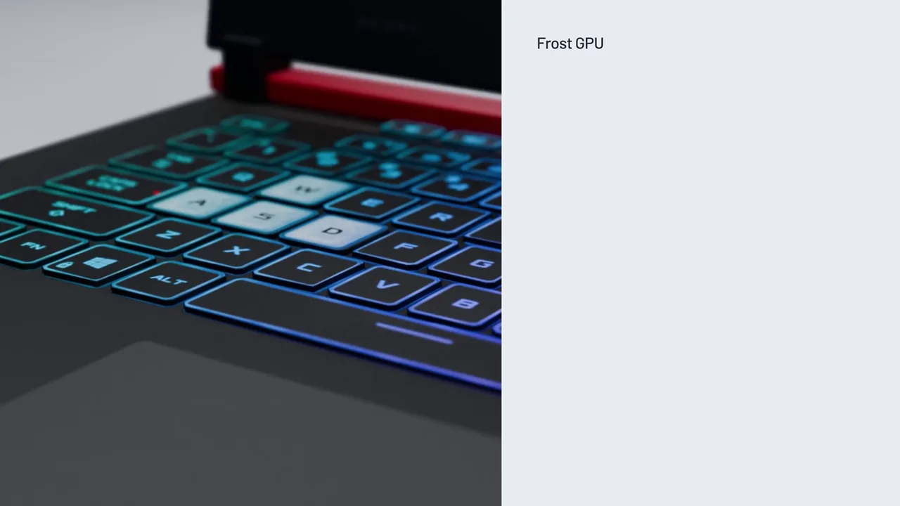
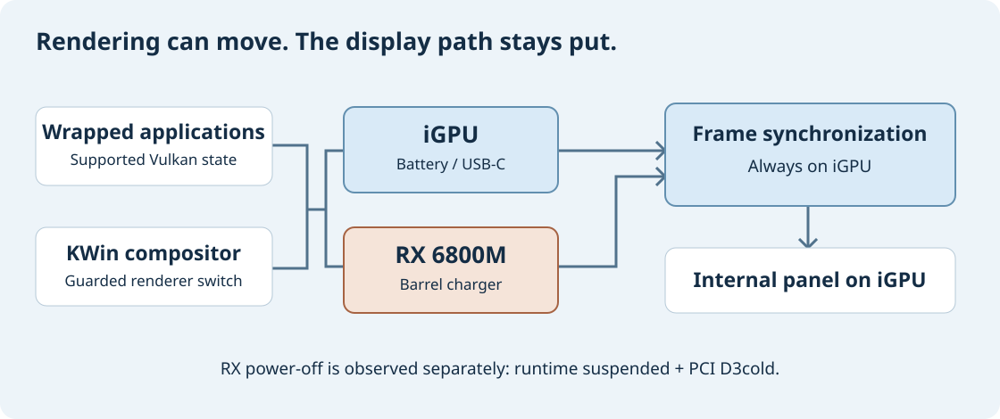

<p align="center">
  <a href="https://github.com/ilyasmohaimel/frost-gpu/blob/main/brag-output-2026-10-19-101407/brag.mp4">
    
  </a>
</p>

<p align="center"><a href="brag-output-2026-10-19-101407/brag.mp4">Watch the full video with sound</a></p>

<p align="center">
  <a href="docs/how-it-works.md">How it works</a> ·
  <a href="docs/app-support.md">App support</a> ·
  <a href="docs/build.md">Build notes</a> ·
  <a href="docs/porting.md">Bring it to your laptop</a> ·
  <a href="docs/recovery.md">Recovery</a>
</p>

[](https://github.com/ilyasmohaimel/frost-gpu/actions/workflows/check.yml)

# Keep the desktop. Change the GPU.

Frost GPU is an experimental KDE Wayland setup that moves KWin and supported
application rendering between an integrated GPU and an RX 6800M while the
session stays open. Unplug the charger, move rendering to the iGPU, and let
the RX enter runtime suspend. Connect the barrel charger and move it back.

Built and tested on an **ASUS ROG G513QY with AMD Vega + RX 6800M**, using
patched [KWin](https://invent.kde.org/plasma/kwin) and
[ZrnSelectiveSuspend](https://github.com/z3r0n3br4instorm/ZrnSelectiveSuspend).
This repository contains the source, patches, test notes, and the details that
made the real desktop work.

**Experimental, with bounded app support.** Apps must start through the right
route. Some stay on the iGPU or use software rendering. State copying can pause
an app. Intel/NVIDIA is a documented porting target, not a tested configuration.

## Three power sources. Two renderers.

| Power source | Desktop renderer | RX runtime policy |
| :--- | :--- | :--- |
| Barrel charger only | RX 6800M | Stay awake |
| USB-C PD | iGPU | Allow runtime suspend |
| Battery | iGPU | Allow runtime suspend |
| USB-C and barrel together | iGPU | USB-C takes priority |

The built-in panel stays physically connected to the iGPU in every mode.
The compositor renderer changes; the panel wiring does not.

On this laptop, `ADP0` reports online for both barrel and USB-C power. The
UCSI USB supply resolves that ambiguity. A generic "AC online" check gets
this policy wrong. [Read the source detection notes.](docs/how-it-works.md#charger-detection)

## The fix that finally let the RX sleep

Moving the apps and KWin to the iGPU was only part of the job. The RX still
woke on every frame because KWin had created its explicit synchronization
manager on the first enumerated render device: the RX.

The fix was to keep **synchronization on the panel's iGPU**, even when the RX
renders the desktop. Renderer selection and synchronization device ordering
must be handled separately.



After a fresh login with that ordering, a physical unplug test moved the
desktop to iGPU and the RX reached **`suspended` + `D3cold`**. Plugging back in
woke the RX and restored its renderer. The monitored application processes
stayed alive. USB-C PD was then tested with the same iGPU and D3cold result.

[The mechanism and tradeoffs](docs/how-it-works.md) ·
[What was actually verified](docs/validation.md)

## A short tour

[Watch or download the MP4](brag-output-2026-10-19-101407/brag.mp4).
A custom G513QY model, an illustrated hardware cutaway, a real Brave screen
recording and paired captures of a manually triggered KWin renderer switch.
The cutaway uses an RX-rendered still with a slow camera push. This is not a
charger-switch timing benchmark.

The [editable composition](brag-output-2026-10-19-101407/composition),
[Blender source](brag-output-2026-10-19-101407/production) and
[storyboard](brag-output-2026-10-19-101407/brag-plan.md) are included.
Music: [“Machina” by Scott Buckley](https://www.scottbuckley.com.au/library/machina/),
[CC BY 4.0](https://creativecommons.org/licenses/by/4.0/).

## What happens to open apps?

| Route | Priority apps | What stays open |
| :--- | :--- | :--- |
| Live render migration | Brave, Codex, T3 Code, VSCodium, WezTerm, Hiddify, rebuilt ROG Control Center | Supported wrapped rendering contexts move between GPUs |
| Native or software compatibility | RedPanda C++, Konsole, Blip, LibreOffice | Tested workflows continue through desktop switches |
| Fixed iGPU | WeChat | The app stays on iGPU through both modes |

The VS Code-family test used **VSCodium**, the installed package. T3's UI
survived both moves; its agent execution and terminal command execution were
not verified. Blip's file transfer finished before the switch. WeChat calls
were deliberately not tested.

[See the full app matrix](docs/app-support.md), including the tested workflows,
the fixes, and the gaps. Games, Proton, compute, advanced Vulkan use, and 32-bit
apps do not have a supported result here.

## Start with inspection

The inspection tool needs Python 3.11+ and writes nothing to system settings:

```sh
git clone https://github.com/ilyasmohaimel/frost-gpu.git
cd frost-gpu
python3 tools/inspect_system.py
python3 tools/inspect_system.py --profile examples/g513qy.json
python3 -m unittest discover -s tests -v
```

It reports graphics PCI devices, DRM nodes, connected outputs, power supplies,
and runtime power state. Review the output before sharing it.

To build the patched upstream sources, follow the [build notes](docs/build.md).
The [G513QY reference](reference/g513qy) contains the tested controller and
session wiring. It is a hardware-specific reference, not a universal installer.
Nothing in the quick start replaces your compositor or enables switching.

## Bring it to your system

Have Intel + NVIDIA, AMD + NVIDIA, or another AMD pair? Start with the
[porting guide](docs/porting.md). It walks through GPU discovery, panel wiring,
charger signals, driver selection, migration tests, power verification, and
recovery. It also explains which parts can be reused and which need new code.

**Changing two PCI addresses is not enough.** Cross-driver migration needs
compatible features, memory handling, synchronization, and presentation. The
NVIDIA offload example in the guide selects a GPU at launch; it does not move
an already running app.

## What you give up

- Some routes use X11 through XWayland instead of native Wayland.
  WezTerm's background blur is restored with a small X11 property bridge.
- Wrapped rendering keeps a RAM copy of relevant state and can pause to move it.
- Screen locking and active capture block compositor changes. Taskbar hover
  previews were disabled on the tested machine because they created capture streams.
- An app, external display, or driver client can still wake the RX.
- KDE, Qt, or Mesa updates can require a rebuild. The reference checks package
  versions and falls back rather than treating an old build as compatible.

There is no battery-life measurement or zero-stutter claim. The original
pointer stutter was intermittent; this work does not establish its root cause.

## Inside the repo

```text
patches/             KWin switch API and ZSS render migration patches
reference/g513qy/    Tested controller, app routes, services, tray, and tests
tools/               Read-only hardware inspection and isolated source preparation
examples/            Hardware mapping used by the inspection tool
docs/                Architecture, app support, build, porting, and recovery
assets/              Project artwork and architecture diagram
brag-output/         Short video, poster, storyboard, and editable composition
brag-output-2026-10-19-101407/  Latest film, matched model source, and real captures
```

## Credits and license

[KDE KWin](https://invent.kde.org/plasma/kwin) provides the compositor.
[ZrnSelectiveSuspend](https://github.com/z3r0n3br4instorm/ZrnSelectiveSuspend)
provides the migration machinery. Mesa's Zink connects the tested OpenGL
routes to Vulkan. Frost GPU adds the local render-only extension, guarded
compositor switching, session integration, charger policy, and app routes.

Original project code and documentation are GPL-2.0-only. Patches retain their
upstream file licenses. [Third-party notices](THIRD_PARTY.md) cover the upstream
sources and video tooling. Built locally and tested on one laptop.
