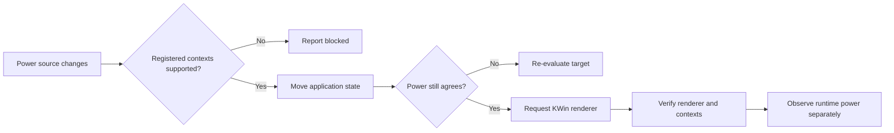

# What moves, what stays

There are three separate jobs: render the application, compose the desktop,
and drive the display. This setup changes the first two. The internal panel
continues scanning out from the iGPU.

## Application rendering

Applications launched through `zss-run` use ZSS's Vulkan driver shim. It tracks
supported objects and keeps the information needed to recreate their state.
The render-only extension adds `move` and `restore` operations. It leaves the
GPU attached to the kernel and does not freeze cgroups or invoke a power-cut
backend.

OpenGL routes use Mesa Zink. Tested Chromium routes use ANGLE Vulkan and
XWayland. The dispatcher selects the route per app rather than setting a
replacement Vulkan driver for the whole login.

An already running app that never loaded the shim cannot be added to this
contract. It needs a relaunch through the dispatcher. A new unsupported Vulkan
feature can make a formerly simple app context non-migratable.

## The compositor

The KWin patch adds an opt-in D-Bus method:

```text
org.kde.KWin /Compositor
  org.kde.kwin.Compositing.switchPrimaryGpu(render_node)
  primaryGpu
  gpuSwitchError
```

It requires `KWIN_ENABLE_EXPERIMENTAL_GPU_SWITCH=1` at startup. The method
validates the device, checks the target EGL context, stops the old compositor
backend, rebuilds on the target, and attempts to restore the old renderer if
the new one fails. It refuses while locked or while a screencast source exists.
The rollback is an attempt, not a promise of crash-free recovery.

The controller first checks registered contexts, then moves supported apps,
checks whether power changed during the move, switches KWin, and verifies the
result. A lost mutation reply halts automatic retries. A blocked compositor
can leave apps on the target while KWin remains on the source; the tray reports
that condition instead of claiming the whole transition finished.



## The synchronization trap

A trace on stable battery power found 1,186 RX runtime-resume events in about
12 seconds, all attributed to KWin. The calls were DRM synchronization-object
operations. The apps and compositor had already moved to the iGPU.

In the pinned KWin source, `WaylandServer::updateSyncobjSupport` takes the first
render device for the explicit-sync manager. Starting on AC with the RX first
created synchronization objects there. Changing the primary renderer later did
not replace those existing timelines.

The reference session therefore resolves the by-path symlinks at login and uses:

```text
KWIN_RENDER_NODES = iGPU render node : RX render node
KWIN_XWAYLAND_RENDER_DEVICE = iGPU render node

KWIN_DRM_DEVICES on barrel = RX card : iGPU card
KWIN_DRM_DEVICES otherwise = iGPU card : RX card
```

These are explanatory placeholders, not literal shell assignments. Use resolved
device paths as `frost_session.py` does. The first two choices stay fixed for
the login; the live API handles subsequent compositor renderer changes.

A cross-GPU syncobj test verified imported timeline signaling in both
directions, eventfd notification, and release of the source handle. A fresh
login was necessary because existing sync objects belonged to the old device.
After that login, real battery tests reached `suspended` and `D3cold`.

## Charger detection

Observed signals on the G513QY:

| Input | `ADP0` / Mains | UCSI USB supply | Decision |
| :--- | :--- | :--- | :--- |
| Battery | Offline | Offline | iGPU |
| Barrel | Online | Offline | RX |
| USB-C PD | Online | Online | iGPU |

USB input wins over `ADP0`, including when both connectors are present. Unknown
external sources use iGPU. The shared Python policy feeds startup, launchers,
the controller, and the runtime-power helper. The tray independently labels
the live source.

`power/control=auto` permits driver-managed runtime suspend. It does not force
an in-use GPU off. The root helper only changes `on` or `auto` after checking
the expected PCI vendor and device. It does not remove the PCI device, unbind
its driver, or unload a module. See the
[kernel runtime PM documentation](https://docs.kernel.org/power/runtime_pm.html).

## Capture and taskbar previews

KWin's taskbar hover previews created internal PipeWire screencasts on the
tested desktop. Those streams correctly triggered the capture guard and kept
a renderer switch blocked. Turning off task-manager hover tooltips removed
the streams. The GPU tray tooltip still works.

The capture guard remains enabled. Stop a screen share or recording before
expecting a compositor switch. This repository does not patch around it.
